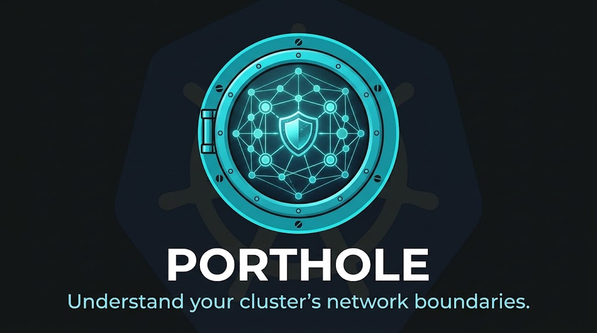
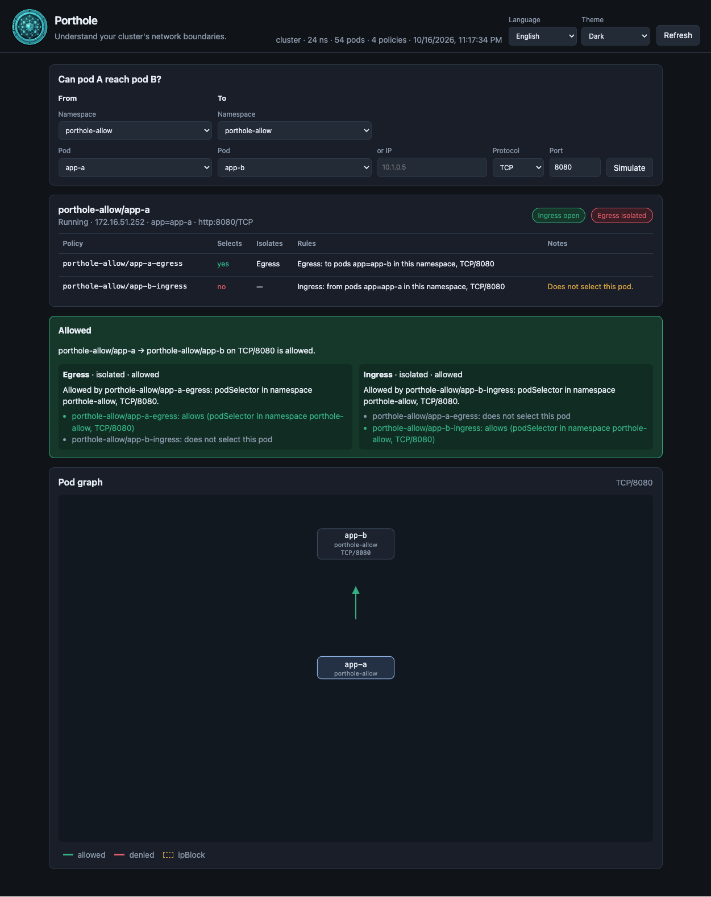
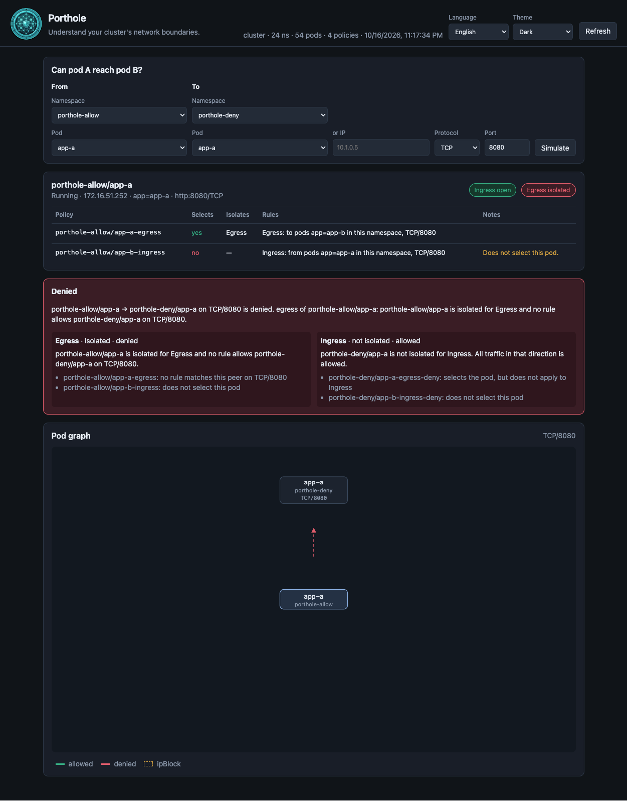

<p align="center">
  
</p>

Lightweight Go tool that reads `networking.k8s.io/v1` `NetworkPolicy` and answers two questions:

- which policies isolate this pod, and what each rule allows;
- can pod A reach pod B on this protocol and port?

It does not send packets. The verdict is the API contract, not a probe. It is for clusters whose CNI implements standard NetworkPolicy and does not have Hubble, Cilium Network Policy Editor, or an equivalent.

## Run the demo without a cluster

```bash
go run ./cmd/porthole serve --manifests testdata/demo
```

Open http://localhost:8080. The snapshot has `app/web`, `app/api`, `app/free`, `app/batch`, and `data/db`.

```bash
go run ./cmd/porthole check --manifests testdata/demo \
  --from app/web --to data/db --port 5432

go run ./cmd/porthole check --manifests testdata/demo \
  --from app/web --to data/db --port 80

go run ./cmd/porthole explain --manifests testdata/demo --pod app/batch
```

`check` exits 0 when the flow is allowed and 1 when it is denied. `--json` prints the full verdict. `--to-ip` tests egress to an external IP. `--from-ip` tests ingress from an IP.

Against a cluster, on your machine, with kubeconfig pointed at it:

```bash
go run ./cmd/porthole serve
```

Open http://localhost:8080. No Deployment is required. The process uses the default kubeconfig, or `--kubeconfig` for a specific file. Do not combine `--kubeconfig` with `--manifests`.

`serve` reloads objects every 15s (`--refresh 0` disables that). The UI has the same refresh button. The default UI language is English; you can switch to Portuguese and toggle light and dark theme in the header.

## Scenarios to apply on a cluster

`examples/` has app-a talking to app-b: one namespace where TCP/8080 is allowed, and one where it is not.

```bash
kubectl apply -f examples/allow.yaml
kubectl apply -f examples/deny.yaml
go run ./cmd/porthole serve
```

Wait until the pods are Running and open http://localhost:8080. Simulate:

- `porthole-allow/app-a` → `porthole-allow/app-b` on port 8080: allowed
- `porthole-allow/app-a` → `porthole-allow/app-b` on port 80: denied
- `porthole-deny/app-a` → `porthole-deny/app-b` on port 8080: denied

In the allowed case, egress from `app-a` and ingress to `app-b` allow only TCP/8080. In the denied case, `app-a` has no egress and `app-b` accepts no ingress.

The same flows from the CLI, without the UI:

```bash
go run ./cmd/porthole check --manifests examples \
  --from porthole-allow/app-a --to porthole-allow/app-b --port 8080

go run ./cmd/porthole check --manifests examples \
  --from porthole-deny/app-a --to porthole-deny/app-b --port 8080
```

The first exits 0. The second exits 1. To remove the scenarios from the cluster:

```bash
kubectl delete -f examples/allow.yaml
kubectl delete -f examples/deny.yaml
```

The same steps are in `examples/README.md`.

## What the screen shows

- English or Portuguese, and a light or dark theme. The choice stays in the browser.
- Namespace and pod for each side of the flow. Policies for pod A sit under the selectors, then the A → B verdict and the reachability graph.
- A table of NetworkPolicies in the namespace: whether they select the pod, which direction they isolate, the text of each rule, and a warning when `policyTypes` was omitted.
- An A → B or A → IP simulation.
- A graph of the selected flow on the chosen port. The arrow from pod A to pod B uses the same verdict as the check: green is allowed, dashed red is denied. With no destination, the graph stays in the pod’s namespace and in namespaces named by a `namespaceSelector` that is not “all”. `ipBlock` entries appear as nodes.

## Semantics

A pod is isolated in a direction when some policy in the namespace selects it and that policy applies to the direction. Without isolation, the direction allows everything. With isolation, the union of the rules applies. The API has no explicit deny.

- Omitted `policyTypes`: Ingress always applies. Egress applies only when an `egress` section exists. A policy that looks egress-only and omits `policyTypes: [Egress]` also closes ingress. `explain` marks this case.
- `podSelector: {}` selects every pod in the namespace. A peer with only `podSelector` looks at the policy namespace. `namespaceSelector` and `podSelector` in the same item are AND. Different list items are OR.
- Absent `from` or `to` allows every peer. Absent `ports` allows every port. An omitted protocol is TCP. A named port matches the destination `containerPort`. `endPort` is an inclusive range.
- A pod-to-pod flow must pass source egress and destination ingress.
- `ipBlock` matches the IP, including a pod IP. The answer warns that this depends on the CNI: the docs say `ipBlock` is for addresses outside the cluster.
- The same pod is treated as allowed. Loopback does not go through NetworkPolicy. Hairpin to the pod’s own IP depends on the CNI.

## Install on a Kubernetes cluster

Inside the cluster, Porthole does not use your kubeconfig. The pod authenticates as a ServiceAccount, and that account is the only identity the UI uses to read the API.

`deploy/porthole.yaml` creates:

- Namespace `porthole`.
- ServiceAccount `porthole` in that namespace.
- ClusterRole `porthole`.
- ClusterRoleBinding `porthole`, which grants that ClusterRole to the ServiceAccount.
- Deployment `porthole`, with `serviceAccountName: porthole` and `automountServiceAccountToken: true`, so the token is mounted and the in-cluster client can use it.
- ClusterIP Service `porthole`.

### Service account and RBAC

The ClusterRole is read-only and cluster-wide. On each reload the process lists every namespace, every pod, and every `networking.k8s.io/v1` NetworkPolicy. A Role in the `porthole` namespace cannot do that: Namespace is not a namespaced object, and pods and policies in other namespaces would be invisible. `namespaceSelector` needs the labels on those namespaces.

```yaml
rules:
  - apiGroups: [""]
    resources: ["pods", "namespaces"]
    verbs: ["get", "list", "watch"]
  - apiGroups: ["networking.k8s.io"]
    resources: ["networkpolicies"]
    verbs: ["get", "list", "watch"]
```

| Resource | What it is read for |
| --- | --- |
| `pods` | Name, namespace, labels, pod IP, container ports, phase, and `hostNetwork`. |
| `namespaces` | Name and labels, so a `namespaceSelector` can be matched. |
| `networkpolicies` | `podSelector`, `policyTypes`, and the ingress and egress rules. |

`get`, `list`, and `watch` are the only verbs. There is no `create`, `update`, `patch`, or `delete`. The role does not grant secrets, configmaps, or any other API group. The process reloads by listing those three resources. It does not write policy.

Running `porthole check` or `porthole explain` on your machine does not use this ServiceAccount. Without `--manifests`, the binary uses the current kubeconfig. The Deployment is only the UI inside the cluster.

You need `kubectl` pointed at the cluster and permission to create those objects, including the ClusterRole. The manifest image is `porthole:dev` with `imagePullPolicy: IfNotPresent`, so the node needs that tag locally, or you change the name to an image in a registry.

Build:

```bash
docker build -t porthole:dev .
```

Deliver the image to the cluster. Pick one:

```bash
# kind
kind load docker-image porthole:dev

# minikube
minikube image load porthole:dev

# k3d
k3d image import porthole:dev

# registry
docker tag porthole:dev ghcr.io/YOUR_USER/porthole:dev
docker push ghcr.io/YOUR_USER/porthole:dev
```

If the published image is not named `porthole:dev`, change the `image` field in `deploy/porthole.yaml` before apply. For a private registry, create an imagePullSecret and reference it in `spec.template.spec.imagePullSecrets`.

Apply and wait until the pod is ready:

```bash
kubectl apply -f deploy/porthole.yaml
kubectl -n porthole rollout status deploy/porthole
kubectl -n porthole get pods,svc
```

The container listens on `:8080` and reloads pods, namespaces, and NetworkPolicies every 15s. Open the UI only through port-forward:

```bash
kubectl -n porthole port-forward svc/porthole 8080:8080
```

Visit http://localhost:8080. Do not publish the Service through Ingress or LoadBalancer: the API shows IPs, labels, and which flows a policy leaves open.

To remove it from the cluster:

```bash
kubectl delete -f deploy/porthole.yaml
```

The ClusterRole and ClusterRoleBinding go with it because they are in the same file. On a large cluster the full pod list stays in memory; the container limit is 256Mi.

## Screenshots

<p align="center">
  
  
</p>

## Limits

It does not evaluate CiliumNetworkPolicy, Calico GlobalNetworkPolicy, AdminNetworkPolicy, or BaselineAdminNetworkPolicy. It does not understand FQDN, L7, or identity. It does not prove that the installed CNI actually enforces what the API says.

## Tests

```bash
go test ./...
```

`internal/eval` does not import client-go. The cases cover isolation, selector AND/OR, additive policies, `ipBlock` and `except`, named ports, `endPort`, the `policyTypes` default, cross-namespace flows, and the same pod.
